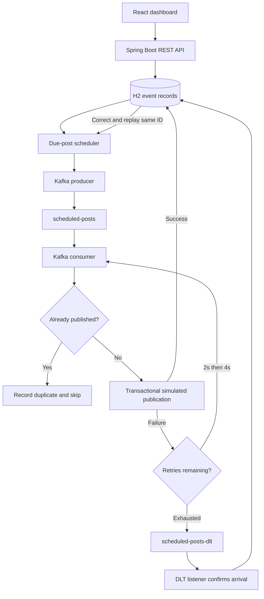

# EventFlow
### Reliable Events. Seamless Delivery.

A complete local React + Spring Boot + Apache Kafka project for two college experiments. The dark dashboard exposes actual persisted events, Spring Kafka retries, dead-letter recovery, and duplicate prevention. **Social media publication is simulated; Kafka processing is real.** No API keys or paid services are needed.

## Start here — Windows + Visual Studio Code

### 1. Install prerequisites

- **Java JDK 17**, for example Eclipse Temurin: https://adoptium.net/temurin/releases/?version=17 . Set `JAVA_HOME` to the JDK installation directory and add its `bin` directory to PATH.
- **Node.js 22 LTS or newer** with npm: https://nodejs.org/ . Node 24 was used for validation.
- **Docker Desktop for Windows**, using Linux containers and the WSL 2 engine: https://docs.docker.com/desktop/setup/install/windows-install/ . Open Docker Desktop and wait for the engine to start. Install WSL when Docker Desktop asks for it, then restart if required.
- **Visual Studio Code**: https://code.visualstudio.com/ . The Extension Pack for Java is helpful but not required.

Extract `EventFlow-Kafka-Project.zip` to a short writable path such as `C:\Projects\EventFlow-Kafka-Project`. Open that extracted folder with **File → Open Folder** in VS Code. The root contains `docker-compose.yml`, `backend`, and `frontend`.

Check in VS Code's PowerShell terminal:

```powershell
java -version
node --version
npm.cmd --version
docker version
docker compose version
```

Use **three terminals**. Leave the backend and frontend terminals running.

### 2. Terminal 1 — start Kafka (project root)

```powershell
docker compose up -d
docker compose ps
docker compose logs -f kafka
```

Wait for the container to become **healthy**, usually 30–90 seconds on first startup. `Ctrl+C` exits the log viewer without stopping Kafka. The first run downloads the pinned `apache/kafka:3.9.1` image.

### 3. Terminal 2 — start the backend

```powershell
cd backend
.\mvnw.cmd spring-boot:run
```

The official Maven Wrapper is included; a separate Maven installation is unnecessary. Its first invocation downloads Maven 3.9.9 and the project dependencies. This can take several minutes. Wait for `Started EventFlowApplication`. The backend listens at **http://localhost:8080**. The `/` route is not a web UI; check **http://localhost:8080/api/system/health** instead.

Linux/macOS equivalent:

```bash
cd backend
chmod +x mvnw
./mvnw spring-boot:run
```

### 4. Terminal 3 — start the frontend

```powershell
cd frontend
npm.cmd install
npm.cmd run dev
```

Open **http://localhost:5173**. `npm.cmd` avoids PowerShell script-execution policy issues; `npm install` and `npm run dev` work in Command Prompt or PowerShell configurations that allow npm.ps1. For reproducible reinstalls, use `npm.cmd ci` with the included lockfile.

### 5. Run your demonstration

The overview contains **Interactive Demo Lab**. Start with Successful Event, then Automatic Retry, Dead Letter Queue, and Duplicate Protection. Visit each dedicated lab for explanations and detailed history. See **TEACHER_DEMO_GUIDE.md** for a 3–5 minute script.

### Stop and restart

Press `Ctrl+C` in the frontend and backend terminals. From the root run `docker compose down`. Kafka's named volume and the backend's `data/` directory persist data. Start all three again to continue. To start completely fresh, stop everything, run `docker compose down -v`, and delete `backend/data/`; **this intentionally deletes your local demonstration history**. Reset both stores together so retained Kafka events do not refer to deleted database records.

## Experiments and objectives

| Experiment | Aim | Observable implementation |
|---|---|---|
| 3.1.1 | Implement asynchronous, event-driven scheduled-post processing | REST API → persisted schedule → due-post scheduler → Kafka producer → topic → Kafka consumer → simulated publication |
| 3.1.2 | Implement reliability using retries, DLQ, and idempotency | Controlled failures, 2s/4s exponential retries, confirmed DLT arrival, same-ID replay, transactional duplicate protection |

The frontend supports eight pages: Overview, Scheduled Posts, Live Pipeline, Retry Mechanism, Dead Letter Queue, Idempotency, History & Analytics, and System Architecture. Animations on the architecture page are explicitly educational; pipeline and demo outcomes are derived from database records.

## Technology and project layout

- Java 17; Spring Boot 3.4.13; Spring Web, Validation, Kafka and Data JPA; file-backed H2; Maven Wrapper 3.9.9.
- Real Apache Kafka 3.9.1, single-node KRaft (no ZooKeeper), three partitions on each application topic.
- React 18, Vite, Tailwind CSS, Framer Motion, Lucide React, Recharts, React Router, Axios, React Hot Toast. Exact frontend versions are pinned in `package.json` and transitive versions in `package-lock.json`.

```text
EventFlow-Kafka-Project/
  backend/
    .mvn/wrapper/maven-wrapper.properties
    mvnw, mvnw.cmd, pom.xml
    src/main/java/dev/eventflow/
      config/        Kafka topics, error handlers, CORS
      controller/    REST routes and database-derived analytics
      consumer/      Main topic and DLT listeners
      dto/           Validated API input and JSON event envelope
      entity/        PostEvent, Publication, Activity
      exception/     Consistent safe API errors
      producer/      Acknowledged durable dispatch
      repository/    JPA access and pessimistic event locking
      scheduler/     Due-post scanning every second
      service/       Transactional state machine and business results
    src/main/resources/application.yml
    src/test/java/dev/eventflow/ReliabilityTest.java
  frontend/
    public/favicon.svg
    src/components/, hooks/, layouts/, pages/, services/
    src/main.jsx, src/styles.css
    package.json, package-lock.json, vite.config.js
    tailwind.config.js, postcss.config.js, index.html
  docker-compose.yml
  .env.example
  README.md
  TEACHER_DEMO_GUIDE.md
  VERIFICATION.md
```

## Architecture



### Scheduled dispatch / producer

`POST /api/posts` persists a record with `SCHEDULED` status and a unique event ID. `scheduledAt` is an ISO-8601 timestamp; the browser converts the selected local date/time to UTC. Every second the scheduler selects at most 50 due records. The dispatcher rechecks the time and state while holding a database row lock, serializes the event to JSON, and waits for Kafka acknowledgements. Only then does it commit `QUEUED`.

The event includes `eventId`, `postId`, `title`, `content`, `platform`, `scheduledAt`, `createdAt`, `failureMode`, and a replay `generation`. The event ID is also its Kafka key, preserving ordering within that event's partition.

If Kafka is unavailable, the event stays scheduled and dispatch is retried. A crash between Kafka acknowledgement and the database commit can cause another delivery; consumer idempotency handles that. This is an at-least-once dispatch design using the persisted schedule as pending work, not a distributed exactly-once transaction.

**Process Now creates a new event** using the existing post content with the current due time. The original future schedule is preserved. Neither this button nor the regular dispatcher bypasses the future event's due-time rule.

### Consumer and simulated publication

The `@KafkaListener` deserializes and checks the message envelope. `EventService.process` locks the existing event row with `PESSIMISTIC_WRITE`. It checks generation and existing publication, records the attempt, and inserts a `Publication` row only for successful processing. That row has the event ID as its primary key. Status, history and publication are committed in the same transaction.

The business effect is deliberately a database row labeled **Simulated Publication**, not an outbound social media call. Instagram, LinkedIn, X and Facebook are platform labels only.

### Exponential backoff

`KafkaConfig` installs `DefaultErrorHandler` with `ExponentialBackOffWithMaxRetries(2)`, a Spring Kafka subclass of `ExponentialBackOff`. Its intervals are **2,000 ms**, then **4,000 ms**, then `STOP`. This is **two retries, three total delivery attempts** in a normal uninterrupted failure cycle.

| Delivery | TRANSIENT scenario | PERMANENT scenario | Next delay |
|---|---|---|---|
| 1 | Controlled failure | Controlled failure | 2 seconds |
| 2 | Controlled failure | Controlled failure | 4 seconds |
| 3 | Success | Failure → DLT | None |

The business method returns a failure message after its transaction commits. The listener then throws outside that transaction, so failed-attempt history is retained. No sleeping occurs in business code. The Spring error handler applies its delay on the consumer thread; the affected partition waits while other partitions can progress. The frontend countdown uses the persisted expected retry timestamp; actual delivery may be later due to scheduling, load, or outages.

Kafka offset delivery is at least once. Restarting a consumer resets the error handler's in-memory retry sequence; lifetime attempts can exceed three after crashes or recovery failures. The persistent `cycleAttempts` is used for the deterministic transient scenario, while `attempts` counts all business attempts across replays.

### Dead letter queue and recovery

`DeadLetterPublishingRecoverer` sends exhausted records to `scheduled-posts-dlt` on the same partition number. Both topics have exactly three partitions. `setFailIfSendResultIsError(true)` ensures a failed DLT publish does not silently count as recovery. A separate listener marks the event `DLQ` **only after consuming the actual DLT record**.

The DLT listener retries database failures indefinitely and does not recursively publish DLT records. Repeated identical DLT deliveries are harmless. If it cannot parse an externally injected invalid message, that DLT partition remains blocked for operator inspection; this classroom application is intended to consume its own validated events.

The correction/reprocess API accepts only a current, uncompleted `DLQ` event. It changes the controlled failure mode to `NORMAL`, increments replay generation, resets cycle attempts, and reschedules the **same identifier** through the real producer. Old-generation deliveries cannot alter the replay. Lifetime attempt and replay counts remain visible. Once successful, replay requests return 409.

### Persistent idempotency and limitations

- Event IDs are primary keys; duplicate creation requests return 409.
- A pessimistic row lock serializes concurrent operations for one event.
- The publication table has a unique primary key equal to the event ID.
- Publication, success status and audit entries commit together.
- A second Kafka delivery increments `duplicates` and adds a visible `DUPLICATE` history entry without performing the business effect again.
- The duplicate demo intentionally sends the same serialized payload twice in the same dispatcher transaction.
- Kafka offset acknowledgement occurs after the business transaction. A crash after commit but before acknowledgement causes a safe duplicate delivery.

This provides one **database-backed simulated publication** per event, not universal exactly-once execution of arbitrary external APIs. A real publisher would need provider idempotency keys or an outbox/inbox design for its external effects. H2 is a local classroom store, not a shared multi-instance production database. Dispatch waits for broker acknowledgements while holding an event lock; it prioritizes understandable recovery over maximum throughput.

## API reference

All successful responses use `{ "data": ... }`; errors use `{ "error": "safe explanation" }`. Times are ISO-8601 UTC; frontend display uses the browser's local timezone.

| Method | Endpoint | Result |
|---|---|---|
| POST | `/api/posts` | 201; validated scheduled event |
| GET | `/api/posts` | 200; events newest first |
| POST | `/api/posts/{eventId}/process-now` | 201; a new immediately due event |
| GET | `/api/dashboard/stats` | Total, success, retry attempts, failed, DLQ, duplicates, rate |
| GET | `/api/events` | Paged history with `search`, `status`, `page`, `size`, `sort`, `order` |
| GET | `/api/events/{eventId}` | Event plus full attempt/activity history |
| GET | `/api/events/activity` | Latest 100 activities, newest first |
| POST | `/api/demo/success` | 202; NORMAL due event |
| POST | `/api/demo/transient-failure` | 202; TRANSIENT due event |
| POST | `/api/demo/permanent-failure` | 202; PERMANENT due event |
| POST | `/api/demo/duplicate` | 202; exact same payload dispatched twice |
| GET | `/api/dlq` | Current unresolved DLQ events |
| POST | `/api/dlq/{eventId}/reprocess` | 202; corrected same-ID replay |
| GET | `/api/system/health` | Kafka/API/database reachability |
| GET | `/api/analytics` | 12-minute processing series; attempt distribution |

History pagination is zero-based. Size is 1–100 (default 10). Sort by `createdAt`, `status` or `attempts`; order is `asc` or `desc`. The CSV button exports all matching rows across pages, not just the visible page. The client quotes cells and neutralizes common spreadsheet formula prefixes.

Create a post from PowerShell:

```powershell
$body = @{
  title = 'My first Kafka post'
  content = 'A scheduled message from EventFlow.'
  platform = 'LinkedIn'
  scheduledAt = (Get-Date).AddMinutes(1).ToUniversalTime().ToString('o')
} | ConvertTo-Json
Invoke-RestMethod -Method Post -Uri http://localhost:8080/api/posts -ContentType 'application/json' -Body $body
```

Optional `eventId` accepts 1–80 letters, digits, hyphens or underscores. Titles are 1–160 characters and content is 1–5,000 characters; blank values are rejected. Allowed platforms are `Instagram`, `LinkedIn`, `X`, `Facebook`. A past due time is allowed and dispatches on the next scheduler pass. Request errors return 400, unknown event 404, conflicting ID/state 409. APIs are local and unauthenticated; do not expose this teaching build publicly.

### Metrics and live updates

- `Total Events`: distinct persisted event IDs, including future schedules.
- `Successfully Processed`: events currently in SUCCESS.
- `Retry Attempts`: recorded processing attempts greater than one within each generation (not scheduled waits).
- `Failed Events`: events currently FAILED or DLQ. A transient failure that later succeeds is not counted here.
- `DLQ Messages`: current unresolved DLQ events; replay removes the item once it becomes scheduled.
- `Duplicates Prevented`: lifetime duplicate delivery detections.
- Success rate uses successful events divided by **all events**, including pending events.
- The chart shows successful publication timestamps and DLT arrival timestamps in one-minute bins over 12 minutes. Historical DLT arrivals remain plotted after recovery.

Most data polls every 1.5 seconds; demo results every 650 ms, pipeline logs every 700 ms, health every 5 seconds. No invented initial data is loaded. Empty charts and empty histories are intentional. Kafka health is briefly cached to avoid continuous metadata requests. Fast intermediate statuses may appear only in persisted history because processing is faster than polling.

## Configuration

Defaults work without `.env` changes. Spring reads OS environment variables, **not root `.env` automatically**. In the backend terminal, if needed:

```powershell
$env:KAFKA_BOOTSTRAP_SERVERS = 'localhost:9092'
$env:FRONTEND_ORIGIN = 'http://localhost:5173'
.\mvnw.cmd spring-boot:run
```

For frontend API override create `frontend/.env.local` containing `VITE_API_URL=http://localhost:8080/api`, then restart Vite. The root `.env.example` documents these values. Host ports are 9092 (Kafka), 8080 (API), 5173 (UI). Broker port 19092 is for Docker-network communication; 9093 is the internal KRaft controller. The API binds to loopback; Compose publishes Kafka on loopback. The default Kafka cluster is single-node with replication factor 1 and is intended for local demonstrations.

## Tests and builds

From `backend`:

```powershell
.\mvnw.cmd test
.\mvnw.cmd clean package
```

Tests start a **real embedded KRaft Kafka broker** using Spring Kafka Test, plus a clean in-memory H2 database. Docker is not required for tests. They cover actual producer/consumer communication, transient timing, DLT routing and replay, duplicate Kafka deliveries, concurrent database protection, future scheduling and Process Now behavior, unique IDs, and the exact backoff sequence.

From `frontend`:

```powershell
npm.cmd ci
npm.cmd run build
npm.cmd run preview
```

The normal frontend URL remains port 5173 with `npm run dev`. `npm run preview` serves the production build on Vite's preview port (4173 by default); set `FRONTEND_ORIGIN=http://localhost:4173` when testing that mode against the API.

See **VERIFICATION.md** for checks actually run in the generation environment and any remaining limitations. Tests are not a claim of production hardening or full fault-injection coverage.

## Troubleshooting

| Symptom | Fix |
|---|---|
| Docker says it cannot connect | Start Docker Desktop, select Linux containers, wait for WSL engine readiness. |
| Kafka stays unhealthy | Inspect `docker compose logs kafka`; verify port 9092 is free and Docker has sufficient RAM. |
| `java` not found / wrong version | Install JDK 17, check JAVA_HOME/PATH, reopen VS Code terminals. |
| Maven Wrapper download fails | Ensure Maven Central is accessible. Configure corporate Maven proxy in `%USERPROFILE%\.m2\settings.xml` if required. |
| PowerShell blocks npm.ps1 | Use `npm.cmd install` and `npm.cmd run dev`; no policy change is needed. |
| Frontend says backend unavailable | Start Spring Boot; check the health URL and backend terminal output. |
| Kafka disconnected but API works | Start Kafka and wait for topic creation; keep the backend running to reconnect. |
| Port 5173 in use | Stop the other Vite process; strictPort prevents silently selecting a different CORS port. |
| Backend port 8080 in use | Stop the conflicting process, or update server port and frontend API URL together. |
| H2 database already in use | Run only one backend against the local file database. |
| Future post seems stuck | Check its local/UTC date and system clock; it should remain SCHEDULED until due. |
| A transient event took longer than 6 seconds | Startup, rebalances, other events on the same partition, and machine load can add time. Delays are minimum policy waits. |
| Retry event remains FAILED | Check DLT broker send and listener health. DLQ is shown only after confirmed DLT receipt. |
| CORS error | Open `http://localhost:5173`, not an alternate host spelling; align FRONTEND_ORIGIN if changing it. |
| Old data appears | Persistence is intentional. Use the coordinated reset instructions above only if history is no longer needed. |

## Design boundaries

This is a single-user local teaching project. There is no authentication or real social media integration. Histories are kept indefinitely and analytics load records in memory, suitable for a classroom dataset rather than a high-volume production workload. Polling shows actual recorded history, not precise transport latency. Kafka transactions are not used; resilience comes from durable pending work, acknowledged sends, at-least-once delivery and transactional business idempotency.

## Primary technical references

- Spring Kafka error handlers, backoff and recovery: https://docs.spring.io/spring-kafka/reference/kafka/annotation-error-handling.html
- Apache Kafka Docker image and setup: https://kafka.apache.org/39/getting-started/docker/
- Spring Boot 3.4 setup: https://docs.spring.io/spring-boot/3.4/installing.html
